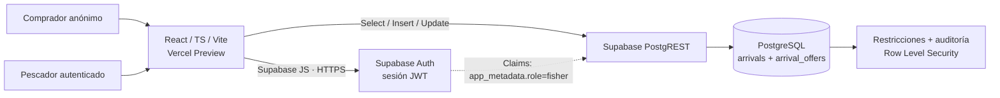

# PFC III Tipo F — Pregunta 3: arquitectura y DevSecOps

> Descripción de lo **implementado** en `test` con verificación GitHub a 21/11/2026. La actividad de monitorización de alertas y el merge a `main` siguen pendientes.

## Arquitectura lógica

No hay backend independiente Node/FastAPI. La API HTTP de datos es Supabase/PostgREST, y la autorización se impone con RLS sobre PostgreSQL. La clave frontend es publishable; nunca `service_role`.

**Consulta del comprador:** navegación anónima `/ofertas` → consultas `is_published` → RLS limita a arribos/ofertas publicados. **Gestión pescador:** `/acceso` → Supabase Auth → `/panel` → permisos por JWT/propietario y RLS. Actualización de consulta: polling cada 30 s después de la respuesta; **no es tiempo real**.

## Stack DevSecOps por fase

| Fase | Implementación | Seguridad integrada |
| --- | --- | --- |
| Plan | Jira PFCEX, 4 épicas, historias, MoSCoW y SP | Criterios de roles, publicación y propiedad |
| Code | GitHub `test`, `main`, PR #1 Draft, TypeScript/ESLint | Code review; no secretos en código |
| Build | GitHub Actions `npm ci`, `tsc -b`, Vite | Dependencias reproducibles; permisos mínimos y SHA pinning |
| Test | Vitest, Testing Library, PGlite, validaciones manuales | RLS con Auth emulado, validación frontend; 133 pruebas reportadas por Codex |
| Release | PR #1 `test→main`, pendiente | Gate de revisión + CI; no fusionado |
| Deploy | Vercel Preview rama `test` | HTTPS y variables limitadas al cliente |
| Operate | Supabase y Vercel MVP | Sesiones, RLS y logs; sin SRE formal |
| Monitor | GitHub Actions, panel de logs Vercel/Supabase | Logs consultables; **no existen alertas automatizadas implementadas** |

## CI/CD: evidencias

Los tres jobs completaron exitosamente: **Quality and npm audit**, **Semgrep CE SAST** (reglas locales verificadas) y **Gitleaks secrets** (historial Git). También se ejecutaron lint, tests y build.

- [GitHub Actions 44973008997](https://github.com/JrP1478/pfciii-examen-base/actions/runs/44973008997)
- [Commit funcional 276f2da](https://github.com/JrP1478/pfciii-examen-base/commit/276f2da5a088be7f18e35a03ca967bcfce293fc1)
- [PR #1 Draft](https://github.com/JrP1478/pfciii-examen-base/pull/1)
- [Vercel Preview](https://pfciii-examen-base-git-test-jrplox987-8298s-projects.vercel.app)

## Justificación y límites

React/Vite simplifica la web pública y el panel; PostgreSQL ofrece relaciones y restricciones para llegadas y ofertas; Supabase elimina el costo/tiempo de crear una API separada y mantiene el control RLS; Vercel facilita el Preview HTTPS; CI automatiza calidad y seguridad. Es coherente con los pescadores que publican y compradores que consultan. No se debe afirmar análisis de seguridad exhaustivo, latencia de tiempo real, alertas productivas, clientes o métricas empresariales inexistentes.

Seguimiento: [PFCEX-19](https://jrplox987.atlassian.net/browse/PFCEX-19).